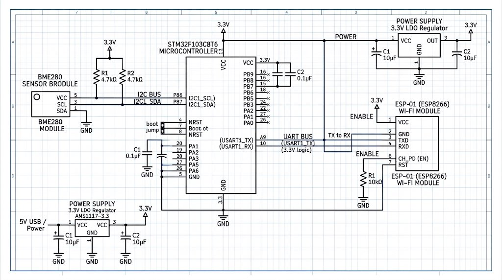

# EXPERIMENT DETAILS

**EXP:** CONTINUOUS ASSESMENT 15 - NODE-RED INTEGRATION

**DATE:** 09/11/2026

**NAME OF EXP:** Node-RED Weather Station Dashboard & Real-Time Meteorological Analytics

**HARDWARE SETUP / PLATFORM:** Node-RED Runtime (v5.0+) + Node-RED Dashboard (`node-red-dashboard`) + MQTT Cloud Broker (`broker.emqx.io:1883`)

---

## TASK 15 - Node-RED : Cloud Telemetry Ingestion & Live Meteorological Dashboard

### 1. Circuit Diagram

The software architecture and data pipeline diagram for the Node-RED environmental monitoring station is shown below:

- **Ingestion Pipeline**:
  - `MQTT In Node`: Connected to `broker.emqx.io:1883` subscribed to topic `college/weather/bme280` receiving JSON payloads `{"temperature":%.2f,"pressure":%.2f,"humidity":%.2f}`.
  - `Simulate BME280 Data`: Preconfigured offline inject node for instant dashboard testing without physical hardware connected.
- **Processing Core**:
  - `BME280 Analytics & Meteorological Engine`: Computes Dew Point temperature (°C), Heat Index / Feels Like (°C), Barometric Altitude (m MSL), and Weather Forecast classification.
- **Visualization Suite**:
  - `Station Overview Card`: HTML5 glassmorphic overview displaying online pulse indicator, primary metrics, and packet count.
  - `Live Environmental Gauges`: Temperature (°C), Humidity (%RH), and Barometric Pressure (hPa) with color-coded warning zones.
  - `Trend Charts`: 1-hour rolling historical line charts tracking ambient shifts.
  - `Push Alerts`: Real-time toast notifications for temperatures exceeding 35 °C or barometric drops below 995 hPa.

### 2. Core Logic / Pseudocode / Code Base

#### Working Principle:
Node-RED acts as a centralized IoT middleware platform that unifies cloud telemetry streaming and data analytics. 

1. **MQTT Telemetry Ingestion**: The `mqtt-in` node connects to `broker.emqx.io:1883`, parses the JSON object received from the STM32 edge node, and feeds it into the analytics function node.
2. **Meteorological Computations**:
   - **Dew Point ($T_{dp}$ in °C)** via Magnus-Tetens approximation:
     $$\alpha = \frac{17.27 \cdot T}{237.7 + T} + \ln\left(\frac{RH}{100}\right), \quad T_{dp} = \frac{237.7 \cdot \alpha}{17.27 - \alpha}$$
   - **Heat Index ($HI$ in °C / Feels Like)** via Rothfusz regression.
   - **Barometric Altitude Estimation ($h$ in meters)**:
     $$h \approx 44330 \times \left(1 - \left(\frac{P}{1013.25}\right)^{0.1903}\right)$$
   - **Barometric Weather Classification**: Identifies High Pressure (Fair & Clear), Normal, or Low Pressure (Storm Risk).
3. **Dashboard UI Rendering**: The processed metrics are distributed to gauge widgets, line charts, numeric cards, and a custom dark-themed summary card accessed via `http://localhost:1880/ui/`.

#### Pseudocode:
1. Establish MQTT subscription to `college/weather/bme280` on `broker.emqx.io:1883`.
2. On message receipt, parse payload into floating-point variables: `temp`, `press`, `hum`.
3. Compute Dew Point ($T_{dp}$) using Magnus coefficients.
4. Calculate Heat Index ($HI$) and convert from Fahrenheit to Celsius.
5. Compute estimated barometric altitude above sea level using standard barometric formula.
6. Evaluate pressure trend: assign forecast status ("Fair & Clear", "Stable", "Rain/Storm Possible").
7. Increment cumulative packet counter and format local timestamp.
8. Output formatted payloads to UI Gauges, History Charts, Overview Card, and Alert Toast.

#### Code Base:
- `flows.json`: Complete, exportable Node-RED flow file containing MQTT configuration, function node, dashboard groups, gauges, and charts.
- `fn_bme280_processor`: Multi-output JavaScript function implementing environmental equations and data routing.
- `card_station_overview`: HTML5/CSS glassmorphic template card rendering live status and metrics.

### 3. Inference
Node-RED successfully bridges the wireless cloud MQTT telemetry stream into an interactive, high-fidelity environmental monitoring station, validating real-time sensor processing, meteorological analytics, and automated alerting for IoT deployments.
