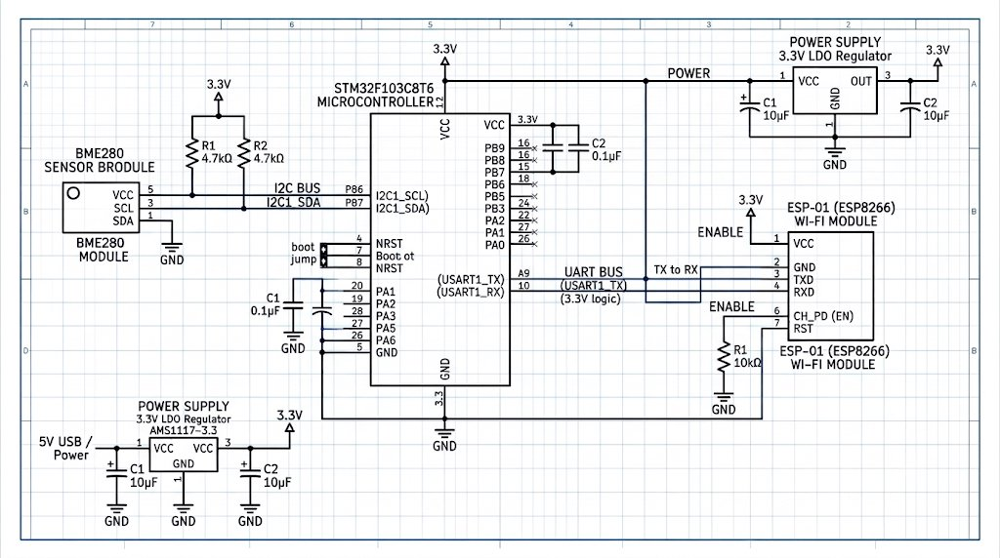

# EXPERIMENT DETAILS

**EXP:** CONTINUOUS ASSESMENT 15

**DATE:** 09/11/2026

**NAME OF EXP:** Environmental Sensing (BME280) & MQTT Cloud Analytics with Node-RED Dashboard

**HARDWARE SETUP / PLATFORM:** STM32 Platform (STM32F103C8T6 / NUCLEO-F401RE) + Bosch BME280 + ESP8266 (ESP-01) + Node-RED Dashboard

---

## Overview

This experiment demonstrates end-to-end IoT cloud telemetry and environmental monitoring. The STM32 NUCLEO-F401RE acquires calibrated atmospheric temperature, barometric pressure, and relative humidity from a Bosch BME280 sensor via I2C. The microcontroller formats structured JSON payloads and dispatches them via UART AT commands to an ESP8266 Wi-Fi modem (ESPLib), publishing telemetry over TCP to a cloud MQTT broker (`broker.emqx.io:1883`) on topic `college/weather/bme280`. A Node-RED server ingests the telemetry stream, executes meteorological algorithms (Dew Point, Heat Index, Estimated Altitude), and renders real-time interactive gauges, rolling trend graphs, and push alerts on an IoT web dashboard.

## Dedicated Tasks

- **[TASK 15: BME280 Environmental Data Acquisition & MQTT Telemetry](TASK15/)**: High-precision I2C sensor sampling, ESPLib MQTT client API, and cloud telemetry transmission.
- **[Node-RED Ingestion Pipeline & Weather Station Dashboard](NodeRED/)**: Real-time MQTT subscription, meteorological analytics engine, and interactive dashboard UI.

### Circuit Diagram

The overall hardware schematic and system pipeline for Continuous Assessment 15 is shown below:

### Inference

An end-to-end industrial IoT environmental monitoring node was successfully deployed. The STM32 NUCLEO-F401RE stably acquires multi-variable atmospheric telemetry from the BME280 sensor and streams formatted JSON payloads over MQTT to a centralized Node-RED dashboard at 5-second intervals with high reliability.
