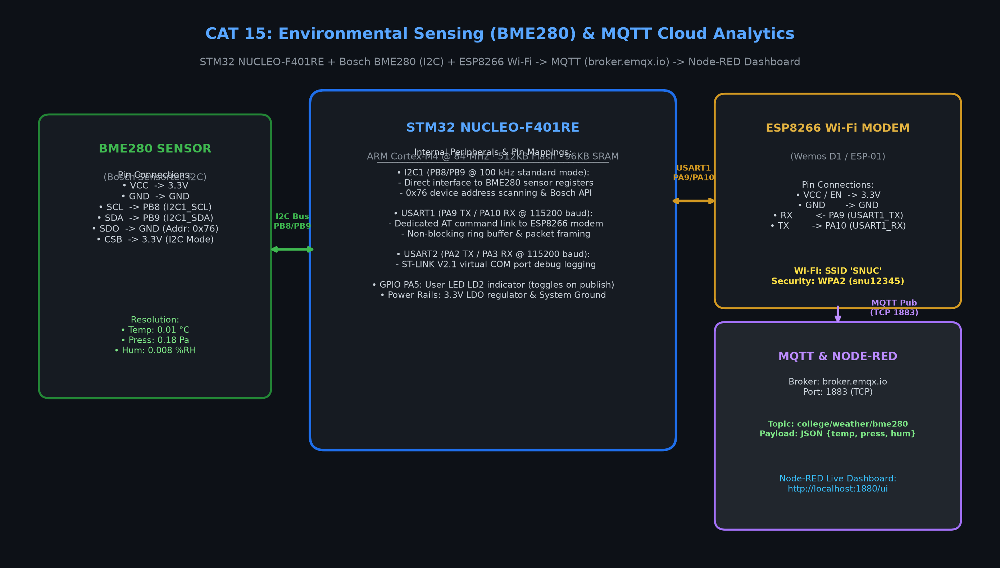

# EXPERIMENT DETAILS

**EXP:** CONTINUOUS ASSESMENT 15 - TASK 15

**DATE:** 09/11/2026

**NAME OF EXP:** BME280 Environmental Data Acquisition & MQTT Cloud Telemetry

**HARDWARE SETUP / PLATFORM:** Keil MDK-ARM + STM32CubeMX + STM32 NUCLEO-F401RE + Bosch BME280 + ESP8266

---

## TASK 15 : BME280 Environmental Sensing & MQTT Transmission

### 1. Circuit Diagram

The circuit diagram and hardware connections for Task 15 are shown below:

- **Microcontroller**: STM32 NUCLEO-F401RE (ARM Cortex-M4 with FPU @ 84 MHz, 3.3V VDD).
- **Bosch BME280 Sensor**:
  - `VCC`: Connected to 3.3V power supply rail.
  - `GND`: Connected to system common GND.
  - `SCL`: Connected to STM32 `PB8` configured as I2C1_SCL (100 kHz standard mode with external/internal pull-up).
  - `SDA`: Connected to STM32 `PB9` configured as I2C1_SDA (100 kHz standard mode with external/internal pull-up).
  - `SDO`: Tied to GND (sets primary 7-bit I2C address to `0x76`).
  - `CSB`: Tied to 3.3V (selects I2C protocol mode).
- **ESP8266 Wi-Fi Modem (Wemos D1 / ESP-01)**:
  - `VCC` & `CH_PD`: Connected to regulated 3.3V rail (capable of 300 mA peak current).
  - `GND`: Connected to common GND.
  - `RX`: Connected to STM32 `PA9` (USART1_TX).
  - `TX`: Connected to STM32 `PA10` (USART1_RX).
- **Debug & Monitoring**:
  - `PA2` (USART2_TX) and `PA3` (USART2_RX) connected via onboard ST-LINK V2.1 virtual COM port to PC @ 115200 baud.
  - `PA5`: User LED (LD2) toggles on each published packet.

### 2. Core Logic / Pseudocode / Code Base

#### Working Principle:
The STM32 NUCLEO-F401RE serves as an edge IoT node that gathers environmental metrics from the Bosch BME280 sensor and transmits them wirelessly to an MQTT cloud broker. 

During bring-up, the system initializes I2C1 on `PB8`/`PB9` and scans for device address `0x76`. Upon detection, the official Bosch BME280 API calibrates the sensor, configures $1\times$ oversampling for temperature, pressure, and humidity, and transitions the ASIC into Normal Power Mode with a 1000 ms standby period.

Concurrently, the firmware initializes USART1 communicating with the ESP8266 Wi-Fi modem via ESPLib. It establishes Wi-Fi association with AP `SNUC` (`snu12345`), opens a TCP connection to `broker.emqx.io:1883`, and issues an MQTT 3.1.1 `CONNECT` frame (`ClientID: STM32_BME280_Device01`, Clean Session).

In the infinite super-loop, the STM32 samples compensated temperature (°C), atmospheric pressure (hPa), and humidity (%RH) every 5 seconds. It formats a standardized JSON message string `{"temperature":%.2f,"pressure":%.2f,"humidity":%.2f}` and dispatches it over topic `college/weather/bme280` using `MQTT_publishTopic(...)`. Visual feedback is indicated by toggling the onboard `PA5` LED.

#### Pseudocode:
1. Initialize HAL library and configure system clock to 84 MHz using internal HSI and PLL (`SystemClock_Config`).
2. Initialize GPIOs (`PA5` as push-pull output for LD2) and USART2 for debug serial logging.
3. Initialize I2C1 peripheral on pins `PB8` (SCL) and `PB9` (SDA) at 100 kHz standard mode.
4. Scan I2C bus: verify acknowledgment from address `0x76` (or `0x77`).
5. Call `bme280_init(&bme280)` and load factory polynomial trimming calibration registers.
6. Configure sensor oversampling settings (`OSR_T = 1X`, `OSR_P = 1X`, `OSR_H = 1X`, `FILTER = OFF`, `STANDBY = 1000MS`) and activate `BME280_POWERMODE_NORMAL`.
7. Initialize USART1 communication with ESP8266 modem at 115200 baud.
8. Call `ESP8266_wifiConnect("SNUC", "snu12345")` to associate with local Wi-Fi.
9. Call `ESP8266_portConnect("TCP", "broker.emqx.io", "1883")` to establish TCP socket.
10. Send MQTT 3.1.1 `CONNECT` packet to broker with Client ID `"STM32_BME280_Device01"`.
11. Main repetitive loop (every 5000 ms):
    - Call `bme280_get_sensor_data(BME280_ALL, &bme280)` to read compensated measurements.
    - Format JSON message buffer: `{"temperature":%.2f,"pressure":%.2f,"humidity":%.2f}`.
    - Call `MQTT_publishTopic("college/weather/bme280", mqttMessage, QoS0)`.
    - Print packet status to USART2 debug terminal.
    - Invert state of `PA5` LED.
    - Delay 5000 ms before next cycle.

#### Code Base:
- `BME280_Init()`: Initializes the Bosch device structure with custom I2C read/write callback wrappers and configures operational oversampling registers.
- `BME280_ReadData()`: Invokes `bme280_get_sensor_data` to read raw ADC registers and apply factory polynomial compensation formulas.
- `ESP8266_wifiConnect("SNUC", "snu12345")`: Issues AT commands to set station mode and associate with the WPA2 Wi-Fi network.
- `ESP8266_portConnect("TCP", "broker.emqx.io", "1883")`: Opens a persistent TCP socket to the remote MQTT broker.
- `MQTT_connectBroker(&mqttConfig)`: Dispatches binary MQTT 3.1.1 CONNECT packet.
- `MQTT_publishTopic(...)`: Formats variable header and payload into an MQTT PUBLISH frame (QoS 0) and transmits through ESP8266 AT send pipeline.

### 3. Inference
The STM32 NUCLEO-F401RE successfully acquires high-accuracy environmental telemetry from the Bosch BME280 sensor and dispatches structured JSON payloads over MQTT to the public EMQX broker, providing a robust edge sensor foundation for downstream cloud visualization and analytics.
